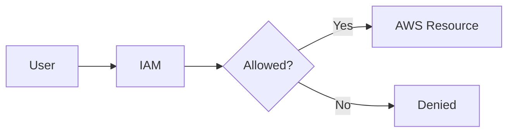
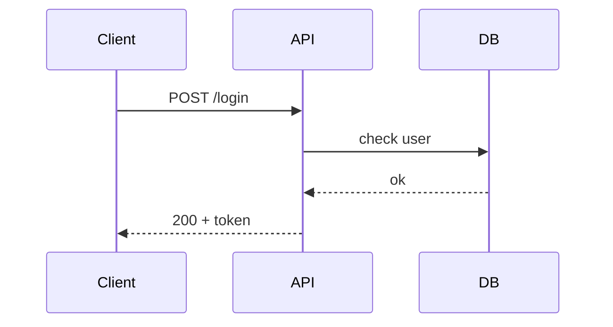

# Markdown Format Guide

Syntax cheat sheet for notes in this site. Copy, paste, adapt.

**Needs** = extension or feature to enable in `mkdocs.yml` (Phase 4). No tag = works out of the box.

---

## 1. Page basics

### Front matter (optional, very top of file)

```yaml
---
title: Custom page title       # overrides H1 in nav/browser tab
description: One-line summary  # used by search engines
tags:                          # Needs: tags plugin
  - git
  - devops
hide:                          # hide sidebars on this page
  - navigation
  - toc
---
```

### Headings

```markdown
# Page title          ← one per page, line 1
## Section            ← appears in right-side TOC
### Subsection
#### Detail           ← avoid deeper than this
```

Custom anchor id — **Needs:** `attr_list`

```markdown
## Installation { #install }
```

### Paragraphs and line breaks

```markdown
Blank line = new paragraph.

Line one\
Line two              ← backslash at line end = line break
```

### Comments (not rendered)

```markdown
<!-- TODO: add examples -->
```

---

## 2. Text formatting

| Result | Syntax | Needs |
|---|---|---|
| **bold** | `**bold**` | — |
| *italic* | `*italic*` | — |
| `code` | `` `code` `` | — |
| strikethrough | `~~text~~` | `pymdownx.tilde` |
| highlight | `==text==` | `pymdownx.mark` |
| underline/insert | `^^text^^` | `pymdownx.caret` |
| H~2~O | `H~2~O` | `pymdownx.tilde` |
| x^2^ | `x^2^` | `pymdownx.caret` |
| keyboard keys | `++ctrl+shift+p++` | `pymdownx.keys` |
| code with highlight | `` `#!python print("hi")` `` | `pymdownx.inlinehilite` |

Escape special char: `\*not italic\*`.

---

## 3. Lists

```markdown
- Item
- Item
    - Nested item     ← 4 spaces, not 2

1. Step one
2. Step two
    1. Sub-step
```

!!! warning "Gotcha"
    Python-Markdown needs **4-space** indent for nesting and a **blank line** before a list. 2 spaces = flat list.

### Task list — **Needs:** `pymdownx.tasklist`

```markdown
- [x] Install MkDocs
- [ ] Deploy to GitHub Pages
```

### Definition list — **Needs:** `def_list`

```markdown
IAM
:   Identity and Access Management.

EC2
:   Virtual servers.
```

---

## 4. Links

```markdown
[External](https://docs.python.org/3/)
<https://example.com>                       ← auto-link

[Same folder](git-commands.md)
[Other folder](../cloud/aws/index.md)
[Heading on same page](#2-text-formatting)
[Heading on other page](git-commands.md#1-git-setup)
```

Rules:

- Link to `.md` files with **relative** paths. MkDocs converts to URLs.
- Never link to `/site/...` or `.html`.
- Heading anchor = lowercase, spaces → `-`, punctuation dropped.
- Check: `mkdocs build --strict` fails on broken links.

### Button — **Needs:** `attr_list`

```markdown
[Open AWS notes](cloud/aws/index.md){ .md-button }
[Primary](cloud/aws/index.md){ .md-button .md-button--primary }
```

---

## 5. Images

Store next to page in `images/` folder, or global `docs/assets/images/`.

```markdown

```

Size, align, lazy load — **Needs:** `attr_list`

```markdown
{ width="400" }
{ align=right width="200" }
{ loading=lazy }
```

Image with caption — **Needs:** `md_in_html`, `attr_list`

```markdown
<figure markdown="span">
  { width="400" }
  <figcaption>VPC architecture</figcaption>
</figure>
```

Tips:

- Diagrams → `.svg` (sharp at any zoom). Screenshots → `.png`.
- Filenames lowercase-hyphen: `vpc-peering.png`.
- Always write alt text.

---

## 6. Tables

```markdown
| Service | Purpose        | Cost  |
|:--------|:--------------:|------:|
| EC2     | Virtual server | $$    |
| S3      | Object storage | $     |
```

- `:---` left, `:---:` center, `---:` right.
- Pipe inside cell: `\|`.
- Inline code and links work inside cells. Lists and code blocks do not.

---

## 7. Code blocks

### Basic, with language

````markdown
```python
def greet(name: str) -> str:
    return f"Hello, {name}"
```
````

Common languages: `bash`, `console`, `python`, `javascript`, `typescript`, `json`, `yaml`, `sql`, `dockerfile`, `terraform`, `hcl`, `powershell`, `bat`, `diff`, `text`.

### Title, line numbers, highlighted lines — **Needs:** `pymdownx.highlight`, `pymdownx.superfences`

````markdown
```python title="app.py" linenums="1" hl_lines="2 3"
def greet(name):
    msg = f"Hello, {name}"
    return msg
```
````

### Code annotations — **Needs:** feature `content.code.annotate`

````markdown
```bash
docker run -p 8080:80 nginx  # (1)!
```

1.  Maps host port `8080` to container port `80`.
````

### Copy button — **Needs:** feature `content.code.copy`

Automatic on every block once enabled.

### Diff

````markdown
```diff
- old_value: 1
+ new_value: 2
```
````

### Show a code fence inside a code fence

Outer fence uses **4** backticks, inner uses 3.

---

## 8. Admonitions (callout boxes)

**Needs:** `admonition`, `pymdownx.details`, `pymdownx.superfences`

```markdown
!!! note
    Default title = type name.

!!! tip "Custom title"
    Content indented 4 spaces.

!!! warning ""
    Empty title = no title bar.
```

Collapsible:

```markdown
??? question "What is IAM?"
    Collapsed by default.

???+ info "Expanded by default"
    Click to collapse.
```

Inline (beside text):

```markdown
!!! info inline end "Side note"
    Floats right of following paragraph.
```

Types: `note` `abstract` `info` `tip` `success` `question` `warning` `failure` `danger` `bug` `example` `quote`.

Suggested use:

| Type | Use for |
|---|---|
| `note` | Key fact |
| `tip` | Shortcut, best practice, interview tip |
| `warning` | Gotcha, breaking change |
| `danger` | Destructive command, data loss |
| `example` | Worked example |
| `question` | Self-test Q&A (collapsible) |

---

## 9. Content tabs

**Needs:** `pymdownx.tabbed` (`alternate_style: true`), `pymdownx.superfences`

````markdown
=== "Linux"

    ```bash
    source .venv/bin/activate
    ```

=== "Windows"

    ```powershell
    .venv\Scripts\activate
    ```
````

Best for: OS-specific commands, language comparisons, before/after.

---

## 10. Diagrams (Mermaid)

**Needs:** `pymdownx.superfences` with `mermaid` custom fence

Flowchart:

````markdown

````

Sequence:

````markdown

````

Other types: `classDiagram`, `stateDiagram-v2`, `erDiagram`, `gantt`, `pie`, `gitGraph`, `mindmap`.
Live editor to draft: <https://mermaid.live>

---

## 11. Footnotes, abbreviations, tooltips

Footnote — **Needs:** `footnotes`

```markdown
S3 offers 11 nines durability.[^1]

[^1]: Source: AWS S3 documentation.
```

Abbreviation (hover shows meaning everywhere on page) — **Needs:** `abbr`

```markdown
IAM controls access.

*[IAM]: Identity and Access Management
```

Link tooltip — **Needs:** feature `content.tooltips`

```markdown
[Hover me](https://example.com "Tooltip text")
```

---

## 12. Icons and emoji

**Needs:** `attr_list`, `pymdownx.emoji` (Material icon index)

```markdown
:material-aws:  :fontawesome-brands-github:  :octicons-rocket-24:  :smile:
```

Search icons: <https://squidfunk.github.io/mkdocs-material/reference/icons-emojis/>

---

## 13. Grid cards (dashboard layout)

**Needs:** `md_in_html`, `attr_list`, `pymdownx.emoji`

```markdown
<div class="grid cards" markdown>

-   :material-cloud: **Cloud**

    ---

    AWS, Azure, core concepts.

    [:octicons-arrow-right-24: Open](cloud/index.md)

-   :material-git: **Git**

    ---

    Commands, SSH, workflows.

    [:octicons-arrow-right-24: Open](git/index.md)

</div>
```

Best for: homepage, section `index.md` pages.

---

## 14. Math (optional)

**Needs:** `pymdownx.arithmatex` + MathJax JS

```markdown
Inline: $O(n \log n)$

Block:
$$
T(n) = 2T(n/2) + O(n)
$$
```

---

## 15. Note-writing tips

- One topic = one file. Split when it passes ~300 lines or has independent subtopics.
- Start with `# Title`, then a 1–2 line summary.
- End with `## Quick revision` (5 bullets) and `## References` (official docs).
- Commands in fences, never plain text. Use `bash` for commands, `console` for commands + output.
- Prefer tables for comparisons, tabs for OS variants, admonitions for gotchas.
- Link related notes instead of copying content.
- Never commit secrets: keys, tokens, passwords, private hostnames.

---

## Extension checklist (feeds Phase 4)

| Extension / feature | Enables |
|---|---|
| `toc` (`permalink: true`) | Heading anchors ¶ |
| `attr_list` | Sizes, buttons, custom ids |
| `md_in_html` | Markdown inside HTML (figures, cards) |
| `admonition` | Callout boxes |
| `pymdownx.details` | Collapsible callouts |
| `pymdownx.superfences` | Nested fences, Mermaid |
| `pymdownx.highlight` | Code title, line numbers, highlights |
| `pymdownx.inlinehilite` | Highlighted inline code |
| `pymdownx.tabbed` | Content tabs |
| `pymdownx.tasklist` | Checkboxes |
| `pymdownx.mark` / `caret` / `tilde` | Highlight, insert, strike, sub/sup |
| `pymdownx.keys` | Keyboard keys |
| `pymdownx.emoji` | Icons |
| `def_list` | Definition lists |
| `footnotes` | Footnotes |
| `abbr` | Abbreviations |
| `content.code.copy` | Copy button |
| `content.code.annotate` | Code annotations |
| `content.tooltips` | Rich tooltips |
