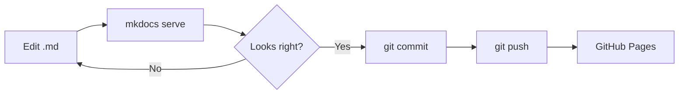
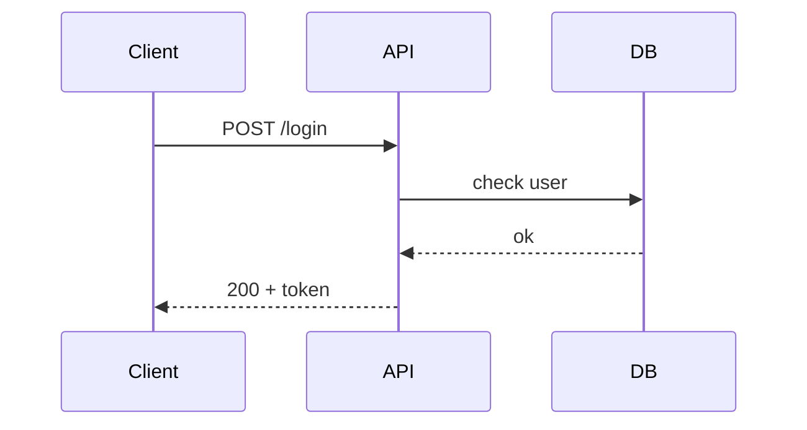

# Format Demo

Live render of every format. Syntax: [Format guide](mkdocs-format-guide.md). Open source file side by side to compare.

---

## 1. Text formatting

**bold** · *italic* · `inline code` · ~~strikethrough~~ · ==highlight== · ^^insert^^ · H~2~O · x^2^

Keys: ++ctrl+shift+p++ · ++ctrl+c++ · ++enter++

Inline highlight: `#!python print("hello")` · `#!bash ls -la`

---

## 2. Lists

- Item
- Item
    - Nested (4 spaces)

1. Step one
2. Step two

Task list:

- [x] Install MkDocs
- [x] Configure `mkdocs.yml`
- [ ] Deploy to GitHub Pages

Definition list:

IAM
:   Identity and Access Management.

EC2
:   Virtual servers.

---

## 3. Links and buttons

[Format guide](mkdocs-format-guide.md) · [Heading on this page](#4-tables) · <https://squidfunk.github.io/mkdocs-material/>

[Open cheat sheet](cheat-sheet.md){ .md-button } [Primary button](cheat-sheet.md){ .md-button .md-button--primary }

---

## 4. Tables

| Service | Purpose | Cost |
|:--------|:-------:|-----:|
| EC2 | Virtual server | $$ |
| S3 | Object storage | $ |

---

## 5. Code blocks

```python title="app.py" linenums="1" hl_lines="2 3"
def greet(name: str) -> str:
    msg = f"Hello, {name}"
    return msg
```

Annotation (click the plus):

```bash
docker run -p 8080:80 nginx  # (1)!
```

1.  Maps host port `8080` to container port `80`.

Diff:

```diff
- mkdocs
+ mkdocs>=1.6,<2
```

---

## 6. Admonitions

!!! note
    Default title = type name.

!!! tip "Custom title"
    Shortcut or best practice.

!!! warning "Gotcha"
    Python-Markdown needs 4-space indent inside blocks.

!!! danger
    `rm -rf` has no undo.

??? question "Collapsible: what is IAM?"
    Identity and Access Management. Controls who can do what.

???+ example "Expanded by default"
    Click title to collapse.

!!! info inline end "Inline note"
    Floats right of next paragraph.

This paragraph sits beside the inline note. Use inline notes for short side facts that should not break reading flow.

---

## 7. Content tabs

=== "Linux"

    ```bash
    source .venv/bin/activate
    ```

=== "Windows"

    ```powershell
    .venv\Scripts\activate
    ```

=== "macOS"

    ```bash
    source .venv/bin/activate
    ```

Same labels link: switch below, tab above follows.

=== "Linux"

    `rm -rf dir`

=== "Windows"

    `rmdir /S /Q dir`

=== "macOS"

    `rm -rf dir`

---

## 8. Mermaid diagrams





---

## 9. Footnotes, abbreviations, tooltips

S3 offers 11 nines durability.[^1]

[^1]: Source: AWS S3 documentation.

Hover the word IAM anywhere on this page.

*[IAM]: Identity and Access Management

[Hover for tooltip](https://www.mkdocs.org "MkDocs official site")

---

## 10. Icons and emoji

:material-aws: :material-microsoft-azure: :fontawesome-brands-github: :fontawesome-brands-python: :octicons-rocket-24: :smile: :white_check_mark:

---

## 11. Grid cards

<div class="grid cards" markdown>

-   :material-cloud:{ .lg .middle } **Cloud**

    ---

    AWS, Azure, core concepts.

    [:octicons-arrow-right-24: Open](../../cloud/index.md)

-   :material-git:{ .lg .middle } **Git**

    ---

    Commands, SSH, workflows.

    [:octicons-arrow-right-24: Open](../git/index.md)

</div>

---

## 12. Image with caption

<figure markdown="span">
  :material-image-outline:{ .lg }
  <figcaption>Figure caption below content</figcaption>
</figure>

Real image: `{ width="400" }` — see [Format guide → Images](mkdocs-format-guide.md#5-images).
